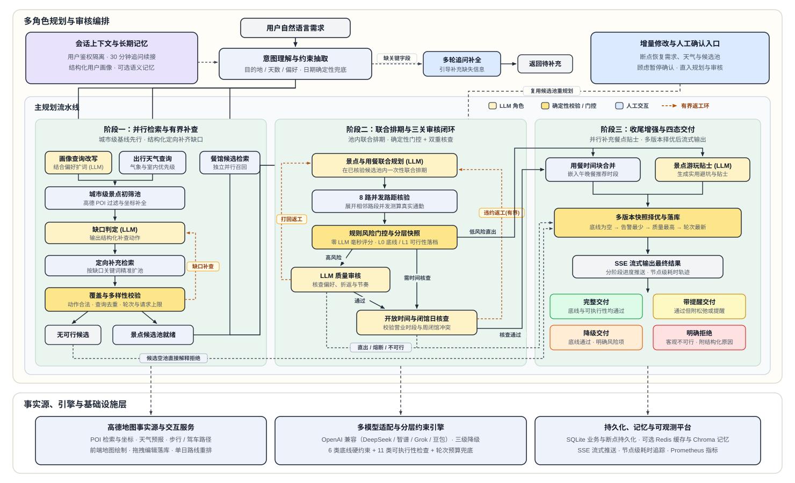

<div align="center">

# TravelMind

**LangGraph 单图多角色编排 · 高德核验候选池 · 分层约束审核闭环 · 可复现评测体系**

<p align="center">     </p>

[项目简介](#项目简介) · [核心工作与结果](#核心工作与结果) · [功能与设计](#功能与设计) · [系统架构](#系统架构) · [快速开始](#快速开始) · [验证与评测](#验证与评测) · [代码与文档](#代码与文档)

</div>


## 项目简介

**一句话定位**：把「周末去成都，想泡茶馆吃火锅，明天中午开始」这类自然语言需求，转化为**逐日可执行、点位可核验、失败可解释**的旅行方案。

直接让大模型生成行程有三类典型故障：编造不存在的地点、排出物理上跑不完的时刻表、把「根本排不出来」的需求包装成看似合理的方案。本系统把生成流程包裹在一圈确定性检查中：先基于高德真实数据构建候选池，再让模型在池内联合排期，最后经规则风险门控、质量审核与开放时间核查三道关卡裁决「完整交付 / 带提醒交付 / 降级交付 / 明确拒绝」。

| 层 | 实际技术选型 | 在本项目里承担什么 |
| :--- | :--- | :--- |
| 编排 | LangGraph 1.2 | 单图多角色共享状态编排：条件路由、并行扇出与汇聚、最多 3 轮有界返工闭环 |
| 服务 | FastAPI + SSE | 流式进度推送、用户鉴权、历史行程管理、单日路线重排、监控指标暴露 |
| 模型 | OpenAI 兼容接口（DeepSeek / 智谱 / Grok / 豆包） | 意图抽取、景点与用餐联合规划、质量审核、开放时间核查、游玩贴士生成 |
| 事实源 | 高德地图 Web 服务（POI / 天气 / 路径规划） | 真实景点与餐馆候选池、气象预报、真实道路距离与通勤耗时 |
| 存储 | SQLite、Redis（可选）、Chroma（可选） | 用户隔离、会话断点复用、响应缓存与长期偏好记忆 |
| 前端 | React 18 + Babel Standalone、高德 JS API | 首页、实时规划看板、行程详情、拖拽重排、历史行程与用户画像 |

**系统能力**：多轮追问补全 · 真实候选池与有界补查 · 景点与用餐一次性联合排期 · 分层约束与多版本择优 · 质量审核与开放时间双关卡 · 断点恢复增量修改 · 单日全排列重排 · SSE 流式可观测 · 不可行请求硬拒绝。

---

## 核心工作与结果

### 1. 单图多角色编排：把「生成」与「校验」拆成有界闭环

以单张共享状态图组织意图理解、并行检索、联合排期与三关审核。意图抽取后并行扇出查询改写、天气查询与餐馆检索三条独立分支，候选池就绪后进入联合排期，再经并发路距核验与风险门控进入审核或直出分支。

- **解决**：串行链路外部接口互相阻塞、返工逻辑分散导致无限重试或在收尾阶段因超步数异常作废。
- **结果**：按完整返工环长（含路距核验、风险门控与快照落档）精确核算迭代预算，并在预算耗尽时自动兜底输出当前最佳草稿与明确告警，不再抛出空结果异常。

### 2. 分层约束与多版本择优：底线与可执行性分离

将路线校验拆为两层：**L0 底线约束（6 类，触及即不可交付）**——池外景点、漏排必去点、天数与结构错误、候选池无可行集、违反纯室内要求、雨天违反室内优先；**L1 可执行性约束（11 类，可返工或降级交付）**——时间轴非法、总时长超限、每日超量、景点重复、开放时间与闭馆日冲突、步行或通勤超限、恶劣天气全室外等。

- **解决**：把「排得不够好」和「行程物理不可行」混成单一失败布尔值，导致前端无法定位原因。
- **结果**：交付状态四分（完整交付 / 带提醒交付 / 降级交付 / 明确拒绝），每版路线附带 L0/L1 校验码存入历史快照，按「L0 为空 → L1 最少 → 软质量最高 → 轮次最新」四级排序择优；拒绝交付时必附结构化失败原因与所处阶段。

### 3. 有界候选补查：确定性基线 + 结构化补缺

将检索与规划彻底解耦：先执行一次城市级确定性检索建立基线候选池（避免单次补查超时导致整城零候选），再由模型输出结构化补查动作，代码侧严格校验动作合法性、查询去重、轮次上限与请求预算，任何越界动作直接丢弃。

- **解决**：让模型自由调用工具容易重复检索同一关键词、陷入无限重试或对不可行边界硬造地点。
- **结果**：在 28 个受控场景中补齐 **28/35** 个非边界缺口（纯种子池基线为 **0/35**），边界场景 **0/14** 被错误补齐；预算合规 **28/28**，单场景最多触发 2 次补充检索（上限 10 次）。

### 4. 三关审核与硬拒绝闭环

路线先经过零模型调用的规则风险评分（实测 7–12ms）：低风险直出，高风险升级至质量审核角色（检查偏好匹配、路线折返与节奏），并独立核查景点开放时间与闭馆日。三道关卡均挂接在同一快照版本上，结合「硬拒绝政策」与「无进展熔断」决策继续返工、直出收尾或直接拒绝。

- **解决**：审核标准不收敛引发多轮无效返工，或尝试用返工挽救客观不可行的需求。
- **结果**：在 2 个下界可证不可行的负样本 × 3 种编排模式下实现 **6/6 正确拒绝**（不安全交付 0/6、部分交付 0/6），拒绝耗时 **16.5–69.0s**（修复前同类请求需 276.8s / 292.1s）。

### 5. 并发路距核验与全链路可观测

将每天相邻点位展开为独立路段，并发请求高德路径规划；单段失败仅剔除该段并记录失败计数，不阻塞整体流程。可观测侧每次运行分配独立运行标识，记录节点级耗时轨迹并暴露 Prometheus 指标，SSE 转发层每轮稳定产出 31 个事件且顺序零错乱。

- **解决**：串行核验 24 段路距耗时超过 7 秒，且线上失败缺乏上下文定位。
- **结果**：在 N=24 段、单段注入 300ms IO 延迟的仿真对照中，核验 P50 从 **7,229.2ms 降至 903.8ms（×7.998）**（N=32 为 ×7.99；串并行同构极差 0.161）；真实高德单次调用 P50 **164.4ms**（12/12 成功）作量级参照。*注：×7.998 为并发度仿真加速比，非线上端到端延迟。*

### 关键量化结果（口径见[验证与评测](#验证与评测)）

| 维度 | 指标 | 结果 | 分子 / 分母 |
| :--- | :--- | :--- | :--- |
| 工程 | 离线测试 | **216 passed**（0 网络） | 31 个测试模块 + 14 个评测测试 |
| 交付质量 | 硬约束通过率 HPR（全链路） | **100%** | 22/22 次 trial |
| 交付质量 | 池外实体率 OOR（全链路） | **0%** | 0/127 个景点引用 |
| 交付质量 | 预期结果匹配率 OMR（全链路） | **68.2%** | 15/22 |
| 编排增益 | HPR（单规划 → 全链路） | **90.9% → 100%** | 同批 22 次/臂 |
| 编排增益 | OMR（单规划 → 全链路） | **36.4% → 68.2%** | 同批 22 次/臂 |
| 编排增益 | 软质量分（单规划 → 全链路） | **77.19 → 87.53** | 同批 22 次/臂 |
| 安全 | 不可行请求正确拒绝率 | **100%** | 6/6 |
| 修改 | 未改内容保留率 | **73.5% → 90.6%（+17.1pp）** | 27 组真实配对 |
| 检索 | 缺口补齐 / 边界误补 | **28/35 · 0/14** | 28 个受控场景 |
| 并发 | 路距核验 P50 | **×7.998** | N=24，18 组矩阵仿真 |

> **口径**：全链路配置（联合规划 + 质量审核 + 开放时间核查）与单规划基线均出自 v1 冻结主集（10 例冻结场景 × 3 臂，每臂 22 次，0 invalid，模型 `glm-4.5-flash`，temperature=0）。

---

## 功能与设计

| 功能 | 实现方式 | 设计目的 |
| :--- | :--- | :--- |
| 需求抽取与多轮补全 | 入口结构化抽取 11 个旅行要素；缺失关键字段时发起追问并保留 30 分钟会话续接，日期与天数由确定性规则兜底 | 不让模型猜测日期和人数，缺信息只追问一次 |
| 真实候选池 | 高德 POI 检索 + 类型/评分过滤 + 坐标补全；任何池外名称在 L0 底线层直接判为不合规 | 从机制上杜绝地点编造，而非依赖提示词约束 |
| 有界补查 | 由模型输出结构化补查动作，代码侧强制校验合法性、去重、轮次与请求预算 | 让模型参与检索决策，但不让它掌控循环终止 |
| 分层校验与择优 | L0/L1 双层校验码 + 历史快照记录 + 四级优先级排序择优 | 保留「次优但可交付」版本，同时向用户说清代价 |
| 增量修改与确认 | 从持久化的会话断点恢复需求、天气与候选池后直入规划与审核；发现潜在冲突时先返回风险提醒待确认 | 局部微调无需重跑检索链路，同时防止越权改掉已有安排 |
| 地图可视化与编辑 | 高德 JS API 渲染每日路线；支持前端拖拽重排并持久化保存，未配置 JS Key 时自动降级为 SVG 示意 | 规划结果必须支持人工微调且修改可落库 |
| 长期记忆 | SQLite 结构化用户画像 + 可选 Chroma 语义记忆（按用户隔离）；画像更新在规划后异步执行 | 个人偏好跨会话沉淀，但不覆盖当次明确诉求 |
| 流式可观测 | SSE 分阶段推送进度与摘要；每次运行保留节点级耗时轨迹与 Prometheus 指标端点 | 长耗时规划过程对用户透明，异常可回溯定位 |

---

## 系统架构



> **架构概览**：上层以单图编排多角色协作——入口完成意图抽取与追问分流后，并行扇出查询改写、天气与餐馆检索，经有界补查构建核验候选池；核心规划在池内一次性联合排期景点与用餐，经 8 路并发路距核验与规则风险门控后进入 LLM 质量审核与开放时间核查闭环；最终由多版本快照择优并流式交付。增量修改支持复用已有断点与候选池直入规划审核阶段。下层统一承载高德事实源、多模型适配与约束引擎、持久化与全链路可观测服务。

### 交付语义

| 状态 | 含义 | 前端表现 |
| :--- | :--- | :--- |
| **完整交付** | 底线与可执行性检查均通过，无告警 | 正常渲染每日行程与地图路线 |
| **带提醒交付** | 核心检查通过，但含策略松弛或审核提醒 | 正常交付行程并附带提醒列表 |
| **降级交付** | 底线约束通过，但仍存在可执行性冲突 | 交付可用路线并明确标出风险项 |
| **明确拒绝** | 无满足底线的候选版本或需求客观不可行 | 不输出空行程卡片，展示结构化拒绝原因与阶段 |

---

## 快速开始

**环境要求**：Python 3.11+（实测 3.12.13）；高德 Web 服务 Key；任一 OpenAI 兼容模型 Key（DeepSeek / 智谱 / Grok / 豆包）。

### 方式一：本地运行

```bash
# 1. 获取代码
git clone https://github.com/zhuo886/Travelmind.git && cd Travelmind

# 2. 创建并激活虚拟环境
python -m venv .venv
# Windows: .venv\Scripts\activate
# macOS / Linux: source .venv/bin/activate

# 3. 安装依赖（国内可加 -i https://pypi.tuna.tsinghua.edu.cn/simple）
pip install -r requirements.txt

# 4. 配置环境变量（复制模板后至少填入 AMAP_API_KEY 与所选模型 Key）
cp .env.example .env.local               # Windows: copy .env.example .env.local

# 5. 启动服务
python run.py
```

### 方式二：Docker 运行

```bash
cp .env.example .env.local               # 编辑填入高德与模型 Key
docker build -t travelmind:latest .
docker run --rm -p 8766:8766 --env-file .env.local -v travelmind-data:/app/data travelmind:latest
```

**访问入口**：

| 入口 | 地址 | 说明 |
| :--- | :--- | :--- |
| 前端界面 | <http://localhost:8766> | 需先注册/登录，规划接口强制 Bearer 鉴权 |
| API 文档 | <http://localhost:8766/docs> | FastAPI 自动生成 OpenAPI 文档 |
| 健康检查 | <http://localhost:8766/api/health> | 返回服务、数据库与缓存连通状态 |
| 节点轨迹排查 | <http://localhost:8766/api/agent-runs/{run_id}> | 按运行标识回查节点耗时与错误码 |

**常见问题**：
- **`ModuleNotFoundError: No module named 'app'`**：请在项目根目录运行命令，或直接使用虚拟环境解释器启动。
- **规划中途提示缺少依赖**：请确认使用的是 `.venv` 内的 Python 解释器而非系统全局 Python。
- **结构化输出连续失败**：所选模型中转不支持 Function Calling 时，在 `.env.local` 中将 `OPENAI_STRUCTURED_METHOD` 设为 `json_mode`。
- **单次规划耗时较长**：可适当调大 `.env.local` 中的规划节点超时配置，或切换响应更快的模型。

---

## 验证与评测

### A. 工程验证（离线、可复现、0 网络）

```bash
python -m pytest -q tests          # 216 passed（0 网络，31 个测试模块 + 14 个评测自检）
```

| 层次 | 覆盖内容 | 代表测试模块 |
| :--- | :--- | :--- |
| 约束与核心规则 | L0/L1 校验码、软质量分、快照择优、容量策略、日期解析、天气规则 | [test_route_quality_rework.py](tests/test_route_quality_rework.py)、[test_intent_dates.py](tests/test_intent_dates.py)、[test_candidate_pool.py](tests/test_candidate_pool.py) |
| 图结构与流式契约 | 并行扇出/汇聚、返工闭环、节点超时终止、递归预算、SSE 事件契约 | [test_graph_parallel.py](tests/test_graph_parallel.py)、[test_reviewer_rework_graph.py](tests/test_reviewer_rework_graph.py)、[test_node_timeout_regression.py](tests/test_node_timeout_regression.py)、[test_sse_contract.py](tests/test_sse_contract.py) |
| 断点与增量修改 | 断点恢复、修改子图路由、风险顾虑中断 | [test_checkpoint_restore.py](tests/test_checkpoint_restore.py)、[test_hotel_anchor.py](tests/test_hotel_anchor.py) |
| 模型调用鲁棒性 | 结构化输出三级降级、粘性切换、鉴权错误不降级、瞬时错误重试 | [test_structured_fallback.py](tests/test_structured_fallback.py) |
| 评测框架自检 | 臂位强制、指标分母、Pass@K、资产指纹、trial 配置快照 | [test_eval_harness.py](tests/test_eval_harness.py)、[test_eval_metrics.py](tests/test_eval_metrics.py) |

### B. 效果评测（冻结输入、真实调用）

评测资产由 [tests/eval/](tests/eval/)（执行器、指标与命令行）、冻结场景输入与 `evaluation/` 原始日志组成，每次 trial 均完整落盘模型与推理配置快照。测试集涵盖南京 / 上海 / 三亚 / 丽江 / 景德镇 × 1/3/5 天 × 晴/雨/超预报/小池/紧时段共 10 个冻结场景，以及 2 个下界可证不可行的安全负样本。

**v1 主集三臂消融**（同冻结集、`glm-4.5-flash`、temperature=0，每臂 22 次，0 invalid）：

| 臂 | 编排配置 | 硬约束通过率 HPR | 预期结果匹配率 OMR | 软质量均分 |
| :--- | :--- | :---: | :---: | :---: |
| A | 单规划基线 | 20/22 = 90.9% | 8/22 = 36.4% | 77.19 |
| B | + 质量审核 | **22/22 = 100%** | **15/22 = 68.2%** | 84.50 |
| **C** | **+ 开放时间核查（全链路）** | **22/22 = 100%** | **15/22 = 68.2%** | **87.53** |

- **质量审核是主要增益来源**：HPR +9.1pp（90.9% → 100%）、OMR +31.8pp、软质量 +7.3；代价为 Token ×3.3、中位延迟 ×3.8。
- **开放时间核查提供边际质量提升**：软质量再 +3.0，HPR 与 OMR 保持持平，延迟增加 38s。

**其他已验证结论**：

| 实验 | 规模 | 结果 |
| :--- | :--- | :--- |
| 硬拒绝回归 | 2 负样本 × 3 臂 | 6/6 正确拒绝，不安全交付 0/6 |
| 必去点注入（v2） | 3 案例 × 3 臂 | 必去满足 9/9；审核使 HPR 66.7%→100%、OMR 33.3%→100% |
| 断点增量修改配对 | 27 组同子图配对 | 未改内容保留率 +17.1pp（73.5% → 90.6%）、硬约束通过率 +11.1pp；输入 Token +6.6% |
| 端到端真实链路 | 4 例（真实高德 + 真实模型） | 2 例交付（208.0s / 241.7s），2 例正确追问（8.6s / 5.4s）；确定性节点合计 <1s |
| 日期解析 | 33 条冻结语料 | 33/33（100%） |
| 语义 Judge | 15 条 × 2 评委 | 均分 78.73，双评一致性 kappa 0.5975 |
| 审核受控挑战 | 6 类注入缺陷 × k=2 | 检出 10/10、正常对照误打回 0/2（关闭思考链时退化为检出 4/5 + 误打回 1/1） |

**复现命令**：

```bash
python -m tests.eval.run_parallel --dry-run --workers 1        # 仅列出评测计划，不消耗额度
python -m tests.eval.e2e_chain --allow-external-calls          # 端到端真实链路（4 例）
python -m tests.eval.date_parsing                              # 日期解析语料（0 网络）
python -m tests.eval.run_trials --version v3 \
  --case nanjing-3d-sunny-history --mode planner_only \
  --allow-external-calls --skip-existing --out evaluation/trials/mine
python -m tests.eval.aggregate_trials --dirs evaluation/trials/mine --out evaluation/trials/mine/final
```

---

## 代码与文档

```text
Travelmind/
├── app/
│   ├── main.py                 # FastAPI 入口：SSE 规划 / 鉴权 / 历史 / 监控指标
│   ├── api/                    # 规划、单日重排、认证、历史与画像路由
│   ├── planning/               # 单图编排、多角色节点、分层约束、有界补查与提示词
│   ├── core/                   # 节点级追踪、缓存、会话断点与语义记忆
│   ├── llm/                    # 多模型适配与结构化输出三级降级
│   └── providers/              # 高德 POI / 天气 / 路径，酒店与门票数据源
├── frontend/                   # React 18 + Babel Standalone（无构建直出）
├── tests/                      # 31 个离线测试模块 + eval/ 评测框架
├── docs/                       # 架构图、评测口径与结果文档、界面截图
└── evaluation/                 # 原始 trial 数据、基准与报告
```

**阅读入口**：

| 想了解 | 看这里 |
| :--- | :--- |
| 图编排、并行分支与预算兜底 | [graph.py](app/planning/graph.py) |
| 多角色节点逻辑与返工路由 | [nodes.py](app/planning/nodes.py) |
| 分层约束、软质量分与择优 | [quality.py](app/planning/quality.py) |
| 有界候选补查与预算控制 | [candidate_react.py](app/planning/candidate_react.py) |
| 多模型适配与结构化输出降级 | [openai.py](app/llm/openai.py) |
| 评测口径与基准报告 | [EVAL_SPEC_V1.md](docs/EVAL_SPEC_V1.md)、[EVAL_RESULTS_V1.md](docs/EVAL_RESULTS_V1.md) |
