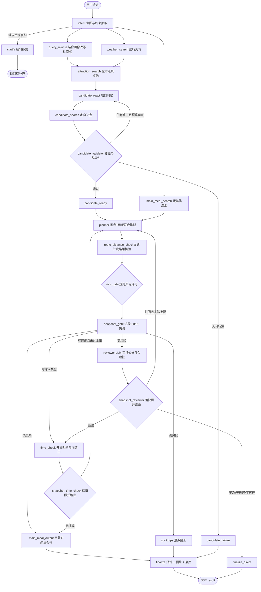

<div align="center">

# 途见 · TravelMind

**LangGraph 单图多角色编排 · 高德核验候选池 · 分层约束审核闭环 · 可复现评测体系**

<p align="center">   </p>

[项目简介](#项目简介) · [核心工作与结果](#核心工作与结果) · [功能与设计](#功能与设计) · [规划流程](#规划流程) · [快速开始](#快速开始) · [验证与评测](#验证与评测) · [代码与文档](#代码与文档)

</div>


## 项目简介

**一句话定位**：把「周末去成都，想泡茶馆吃火锅，明天中午开始」这类自然语言需求，变成一份**逐日可执行、点位可核验、失败可解释**的行程。

LLM 直接写行程有三类典型故障：编造不存在的地点、排出物理上跑不完的时刻表、把「这份需求根本排不出来」包装成一份看起来正常的行程。本系统不讨论「如何让模型写得更好」，而是**把生成放在一圈确定性检查流程中**：先建一个真实候选池，再让模型在池内选点，最后用规则、LLM 审核与开放时间核查三道关卡决定「交付 / 降级交付 / 拒绝」。

| 层   | 实际技术选型                                                 | 在本项目里承担什么                          |
| --- | ------------------------------------------------------ | ---------------------------------- |
| 编排  | LangGraph  `StateGraph` + Pydantic `TravelPlanState`   | 22 个节点的共享状态图：条件边、并行扇出/汇聚、最多 3 轮返工环 |
| 服务  | FastAPI + SSE                                          | 流式进度、登录鉴权、历史行程、单日重排、Prometheus 指标  |
| 模型  | 任意 OpenAI 兼容接口（DeepSeek / 智谱 GLM / Grok / 豆包）          | 意图抽取、联合规划、LLM 审核、开放时间核查、贴士生成       |
| 事实源 | 高德地图 Web 服务（POI / 天气 / 路径规划）                           | 候选池、天气预报、道路距离与通勤时间                 |
| 存储  | SQLite（用户 / 行程 / 画像 / 快照）、Redis 缓存（可选）、Chroma 语义记忆（可选） | 用户隔离、checkpoint 复用、长期偏好            |
| 前端  | React 18 + Babel Standalone、高德 JS API                  | 首页、规划、行程详情、拖拽编辑、历史、画像              |

**系统能力**：多轮补全与追问 · 真实候选池与有界补查 · 景点与用餐一次性联合排期 · 分层硬约束检查与快照择优 · LLM 审核 + 开放时间核查双关卡 · 从 checkpoint 的增量修改 · 单日路线全排列重排 · SSE 流式进度与节点级可观测 · 不可行请求硬拒绝。

## 核心工作与结果

### 1. 单图多角色编排：把「生成」与「校验」拆成可回退的环

用一张 `StateGraph` 编排 22 个节点、6 组条件边。意图抽取后**并行扇出**三条独立分支（查询改写 / 天气 / 餐馆候选），`query_rewrite + weather_search` 汇聚到景点检索；候选池就绪后与餐馆候选一起汇聚到 `planner`；规划结果经并发路距核验 → 风险门控 → 分支到审核或直出。

- 解决：串行链路里每个外部 API 都在阻塞下一步；返工逻辑散落在各节点里无法收敛。
- 结果：一轮 `planner ⇄ reviewer` 实际是 **6 步**（planner → 路距 → risk_gate → snapshot → reviewer → snapshot）；此前的旧公式在 4 轮返工时把 34 步预算耗尽，25 分钟的规划在收尾阶段抛 `GraphRecursionError` 全部作废。现在预算按真实环长计算，并对预算耗尽做**兜底收束**（返回当前最佳草稿 + 明确告警，而不是空结果）。

### 2. 分层约束：L0 底线与 L1 可执行性分开

把检查分成两层：**L0（6 类，触及即不可交付）**——池外景点、漏排点名景点、天数/结构错误、候选池无可行集、纯室内要求被违反、雨天室内优先被违反；**L1（11 类，可返工或降级交付）**——时间轴非法、总时长超限、每日超量、景点重复、开放时间/闭馆日冲突、步行超限、通勤时间不足、习惯约束、物理时间不可行、全程恶劣天气全室外等。

- 解决：把「模型没说好」和「这份行程根本没法走」混成一个布尔值，前端只能显示「失败」。
- 结果：交付语义四分（`SUCCESS` / `SUCCESS_WITH_WARNINGS` / `PARTIAL_SUCCESS` / `FAILED`），每版路线连同 L0/L1 码写入 `route_history` 快照，`choose_snapshot` 按「L0 空 → L1 最少 → 软质量最高 → 轮次最新」择优；`FAILED` 必带 `failure_reasons[].code/stage`，前端可定位到具体检查项。

### 3. 有界 ReAct 候选补查

 把检索与生成解耦：先做一次城市级确定性检索建立基线池（避免 ReAct 超时把整城打成 0 候选），再由 `CandidateDecision` 输出结构化动作，代码侧校验动作合法性、查询去重（、轮次上限与 HTTP 预算，任何越界动作直接丢弃。

- 解决：让模型「自由调用工具」会重复查同一个词、无限重试、对边界情况硬造景点。
- 结果：28 个受控场景中补齐 **28/35** 个非边界缺口（仅种子池基线为 **0/35**），边界场景 **0/14** 被错误补齐；预算合规 **28/28**，单场景最多 2 次检索（上限 10）。

### 4. 三关审核闭环

 先用规则给路线打风险分（零 LLM，实测 7–12ms），低风险直出、高风险升级到 `reviewer`（LLM 判断偏好/折返/节奏），再 单独核验开放时间与闭馆日。三道关卡都挂在同一张快照上，再决定「继续返工 / 进入收尾 / 直接拒绝」。

- 解决：审核不收敛（同一份路线被打回 4 轮）、返工救不了客观不可行的需求。
- 结果：新增**硬拒绝政策**，不再「带警告交付」+ **无进展熔断**+ 快照上限收敛。2 个「下界证明不可行」的负样本 × 3 种编排模式 = **6/6 CORRECT_REJECT**，不安全交付 0/6、部分交付 0/6，拒绝耗时 16.5–69.0s（修复前同类请求需 276.8s / 292.1s）。

### 5. 并发路距核验与节点级可观测

把每天相邻节点展开成独立路段，并发请求高德路径规划，单段失败只丢该段并计入「N 段中失败 M 段」。可观测侧：每次运行有 `run_id` 与节点级 span 可回查、 暴露 Prometheus 文本（、SSE 每轮 31 个事件且顺序不变量违反 **0**。

- 解决：串行核验 24 段路距要 7 秒以上；失败无上下文，只能看到「规划执行失败」。
- 结果：N=24、单段注入 300ms 的 IO 等待仿真中，P50 **7,229.2ms → 903.8ms（×7.998）**，N=32 为 ×7.99；同构自检串并行极差 0.161（阈值 0.35）；真实高德单次调用 P50 **164.4ms**（12/12 成功）作为量级参照。**这是并发度收益的仿真值，不是线上延迟。**

### 关键量化结果（口径见[验证与评测](#验证与评测)）

| 维度   | 指标                     | 结果                         | 分子/分母               |
| ---- | ---------------------- | -------------------------- | ------------------- |
| 工程   | 离线测试                   | **211 passed**，4.98s，0 网络  | 31 个测试模块 + 14 个评测测试 |
| 交付质量 | 硬约束通过率 HPR             | **97.0%**                  | 64/66 次 trial       |
| 交付质量 | 池外实体率 OOR              | **0.49%**                  | 2/405 个景点引用         |
| 交付质量 | 预期结果匹配率 OMR            | 57.6%                      | 38/66               |
| 编排增益 | OMR（planner→+reviewer） | **40.0% → 80.0%**          | 10 例 × 2 臂          |
| 编排增益 | 软质量分（确定性 6 维）          | 78.17 → 85.20              | 同上                  |
| 安全   | 不可行请求正确拒绝率             | **100%**                   | 6/6                 |
| 修改   | 未改内容保留率                | **73.5% → 90.6%（+17.1pp）** | 27 组真实配对            |
| 检索   | 缺口补齐 / 边界误补            | 28/35 · 0/14               | 28 个受控场景            |
| 并发   | 路距核验 P50（仿真）           | **×7.998**                 | N=24，18 组矩阵         |

## 功能与设计

| 功能        | 实现方式                                                                                                  | 设计目的                          |
| --------- | ----------------------------------------------------------------------------------------------------- | ----------------------------- |
| 需求抽取与多轮补全 | `intent` 节点用结构化输出抽 11 个字段；缺字段时 `clarify` 追问并保留 30 分钟 `thread_id` 续接；日期/天数由确定性解析兜底                     | 不让模型「猜」日期和人数，缺信息就问一次          |
| 真实候选池     | 高德 POI 检索 + 类型/评分过滤 + 坐标补全；池外名称在 L0 直接判 `unknown_poi`                                                 | 从机制上禁止编造地点，而不是靠提示词约束          |
| 有界补查      | `candidate_react` 出结构化动作，代码校验合法性、去重、轮次与 HTTP 预算                                                       | 让模型参与决策，但不让它掌控循环              |
| 分层校验与择优   | L0/L1 码表 + `route_history` 快照 + `choose_snapshot` 四级排序                                                | 保留「次优但可交付」的版本，同时说清代价          |
| 增量修改      | SQLite checkpoint恢复需求/天气/候选池 → `build_modification_graph` 只跑规划与审核；有顾虑时返回 `modification_warning` 等用户确认 | 改一餐不要重跑整条链路；同时避免把用户没要求的改动偷偷做掉 |
| 地图与编辑     | 高德 JS API 绘制路线；`SortableJS` 拖拽排序 + `PUT /api/plan/{id}/timeline` 落库；无 JS Key 时降级为 SVG 示意              | 规划结果必须可被人手改，且改动要能持久化          |
| 长期记忆      | SQLite 结构化画像 + 可选 Chroma 语义记忆（按 user 隔离）；画像更新由独立 agent 异步执行                                           | 偏好跨会话生效，但不抢占当次明确需求            |
| 流式可观测     | SSE `stage` / `stage_summary` / `result` 事件；`run_id` + 节点 span + `/api/metrics`                       | 3 分钟以上的规划必须能看见「现在卡在哪」         |

## 规划流程



> 图中省略两处实现细节：① `snapshot_time_check` 在「风险门控复核后仍需重审」时还有一条直连 `reviewer` 的边；② `planner` 的两条条件边（进入主循环 / 回到时间核查）都先经过 `route_distance_check`，因此图上合并为一条。完整节点与边以 `app/planning/graph.py` 为准。

### 终态语义

| 状态                      | 含义                | 前端表现                                             |
| ----------------------- | ----------------- | ------------------------------------------------ |
| `SUCCESS`               | L0 / L1 均通过，无告警   | 正常交付                                             |
| `SUCCESS_WITH_WARNINGS` | 通过但带松弛或审核提醒       | 正常交付 + 提醒列表                                      |
| `PARTIAL_SUCCESS`       | L0 通过、仍有 L1 问题    | 交付路线 + 明确风险项                                     |
| `FAILED`                | 无 L0 合格版本 / 客观不可行 | 空 `days` + `failure_reasons`（含 `code` / `stage`） |

## 快速开始

**环境要求**：Python 3.11+（实测 3.12.13）；高德 Web 服务 Key；任一 OpenAI 兼容模型 Key（DeepSeek / 智谱 / Grok / 豆包）。

```bash
# 1. 获取代码
git clone <your-repo-url> Travelmind && cd Travelmind

# 2. 虚拟环境
python -m venv .venv
# Windows
.venv\Scripts\activate
# macOS / Linux
source .venv/bin/activate

# 3. 依赖（国内建议加 -i https://pypi.tuna.tsinghua.edu.cn/simple）
pip install -r requirements.txt
pip install -r requirements-dev.txt      # 仅跑测试时需要

# 4. 环境变量
cp .env.example .env.local               # Windows: copy .env.example .env.local
# 编辑 .env.local，至少填 AMAP_API_KEY 与所选提供商的 Key

# 5. 启动
python run.py
```

访问地址：

| 入口     | 地址                                              | 说明                                                   |
| ------ | ----------------------------------------------- | ---------------------------------------------------- |
| 前端     | <http://localhost:8766>                         | 先注册/登录，规划接口强制 Bearer 鉴权                              |
| API 文档 | <http://localhost:8766/docs>                    | FastAPI 自动生成（`/openapi.json`）                        |
| 健康检查   | <http://localhost:8766/api/health>              | `{"status":"ok","database":"ok","redis":"disabled"}` |
| 失败排查   | <http://localhost:8766/api/agent-runs/{run_id}> | 节点级 span 与错误码                                        |


**常见问题**

- `ModuleNotFoundError: No module named 'app'`：在项目根目录执行，或使用绝对路径解释器。
- 规划跑到一半报 `DEPENDENCY_MISSING`：用了全局 Python 启动，缺 `langchain-openai` / `httpx`，改用 `.venv` 解释器。
- `结构化输出连续 3 次返回 None`：端点的 function calling 不可用，把 `OPENAI_STRUCTURED_METHOD` 调成 `json_mode`。
- 单次规划耗时 3–10 分钟：`glm-4.5-flash` 等模型的延迟抖动，可调大 `NODE_TIMEOUT_PLANNER_SECONDS` 或换更快的模型。

## 验证与评测

### A. 工程验证（离线、可复现、0 网络）

```bash
python -m pytest -q tests          # 211 passed in 4.98s（2026-11-09 实测）
```

| 层次      | 覆盖内容                                        | 代表文件                                                                                                              |
| ------- | ------------------------------------------- | ----------------------------------------------------------------------------------------------------------------- |
| 单元      | L0/L1 码表、软质量分、快照择优、容量策略、日期解析、天气暴露规则         | `test_route_quality_rework.py`、`test_intent_dates.py`、`test_candidate_pool.py`                                    |
| 图结构     | 并行扇出/汇聚、返工环、节点超时终止、递归预算、SSE 事件契约            | `test_graph_parallel.py`、`test_reviewer_rework_graph.py`、`test_node_timeout_regression.py`、`test_sse_contract.py` |
| 持久化     | checkpoint 恢复、修改图路由、顾虑中断                    | `test_checkpoint_restore.py`、`test_hotel_anchor.py`                                                               |
| 外部依赖鲁棒性 | 结构化三级降级、粘性切换、鉴权错误不降级、瞬时错误重试                 | `test_structured_fallback.py`                                                                                     |
| 评测框架自检  | harness 臂位强制、指标分类与分母、Pass@K、资产指纹、trial 配置快照 | `test_eval_*.py`（14 个文件）                                                                                          |

### B. 效果评测（真实调用，冻结输入）

评测三件套：`tests/eval/`（harness + 指标 + CLI）、`tests/eval/fixtures*/`（冻结候选池与输入）、`evaluation/**`（原始 JSON 与报告）。所有 trial 记录 `llm_config` 快照（model / provider / thinking / max_tokens / structured_method），避免「事后不知道这批用的什么配置」。

**测试对象**：10 个冻结 fixture（南京 / 上海 / 三亚 / 丽江 / 景德镇 × 1/3/5 天 × 晴/雨/超预报/小池/紧时段），v3 增补 2 个「下界证明不可行」的安全负样本。冻结模式下 intent、候选补查、路距核验被跳过，因此 `candidate_api_calls` 恒为 0 属预期。

**三臂消融**（同 fixture、同模型 `glm-4.5-flash`、temperature=0，每臂 10 次，S2 批，0 invalid）：

| 臂 | 编排             | OMR       | 软质量   |
| - | -------------- | --------- | ----- |
| A | `planner_only` | 40.0%     | 78.17 |
| B | `+ reviewer`   | **80.0%** | 85.20 |
| C | `+ time_check` | **80.0%** | 85.77 |

**66 次全量（S1+S2+S3）汇总**：`FDR 81.8% / PDR 15.2% / OMR 57.6% / HPR 97.0% / OOR 0.49% / 软质量 83.07`，端到端 median 202.2s、P95 476.4s。稳定性（S3，k=3）：A 臂 `pass@3 1/2`、`pass^3 0/2`；B/C 臂均 `2/2`、`2/2`。

**其他已验证结论**：

| 实验                | 规模                  | 结果                                                                                                                       |
| ----------------- | ------------------- | ------------------------------------------------------------------------------------------------------------------------ |
| 硬拒绝回归             | 2 负样本 × 3 臂         | 6/6 CORRECT_REJECT，不安全交付 0/6                                                                                             |
| 必去点注入（v2）         | 3 案例 × 3 臂          | MSR 9/9；Reviewer 使 HPR 66.7%→100%、OMR 33.3%→100%                                                                         |
| checkpoint 配对（E2） | 27 组同子图配对           | 保留率 +17.1pp、硬约束通过率 +11.1pp；P50 −11.7%（剔除重试后 −0.4%，**不显著**）、输入 Token **+6.6%**                                            |
| 端到端真实链路           | 4 例（真实高德 + 真实模型）    | 2 例交付（208.0s / 241.7s），2 例正确追问（8.6s / 5.4s）；耗时集中在 LLM 节点（planner 累计 30.0s / 59.6s、reviewer 累计 73.9s / 41.9s），确定性节点合计 <1s |
| 日期解析              | 33 条冻结语料            | 33/33（100%）                                                                                                              |
| 语义 Judge          | 15 条 × 2 评委（思考链开启批） | 均分 78.73，双评 kappa 0.5975                                                                                                 |
| Reviewer 受控挑战     | 6 类注入缺陷 × k=2       | 检出 10/10、正常对照误打回 0/2；关思考链的同一批退化为检出 4/5 + 误打回 1/1                                                                         |

**复现命令**：

```bash
python -m tests.eval.run_parallel --dry-run --workers 1        # 只列计划，不烧额度
python -m tests.eval.e2e_chain --allow-external-calls          # 端到端真实链路（4 例）
python -m tests.eval.date_parsing                              # 日期解析语料（0 网络）
python -m tests.eval.run_trials --version v3 \
  --case nanjing-3d-sunny-history --mode planner_only \
  --allow-external-calls --skip-existing --out evaluation/trials/mine
python -m tests.eval.aggregate_trials --dirs evaluation/trials/mine --out evaluation/trials/mine/final
```

## 代码与文档

```
Travelmind/
├── app/
│   ├── main.py                 # FastAPI 入口：SSE 规划 / 鉴权 / 历史 / 指标挂载
│   ├── api/                    # plan_routes（含单日重排）/ auth / history / profile
│   ├── planning/
│   │   ├── graph.py            # 生产图、修改图、确认图、递归预算与兜底收束
│   │   ├── nodes.py            # 节点工厂：intent / planner / reviewer / time_check / risk_gate
│   │   ├── quality.py          # L0/L1 码表、软质量分、快照择优、硬拒绝判定
│   │   ├── candidate_react.py  # 有界 ReAct 补查与候选校验
│   │   ├── schemas.py          # TravelPlanState 与全部结构化输出模型
│   │   ├── helpers.py          # 日期解析、POI 归一、开放时间、结构化调用重试
│   │   └── prompts.py          # 9 个角色 Prompt（意图/规划/联合规划/审核/时间/餐饮/贴士/改写/画像）
│   ├── core/                   # agent_runs（run_id + 节点 span）/ cache / memory / 观测
│   ├── llm/                    # 提供方适配（openai 兼容 + 结构化三级降级）
│   └── providers/              # 高德 POI / 天气 / 路径，酒店与门票
├── frontend/                   # React 18 + Babel Standalone（无构建），零打包
├── tests/                      # 31 个测试模块 + eval/ 评测框架
├── docs/                       # 评测口径与结果、交接文档、截图
└── evaluation/                 # 原始 trial JSON、benchmark、报告
```

**阅读入口**

| 想了解       | 看这里                                                                                  |
| --------- | ------------------------------------------------------------------------------------ |
| 图怎么连、环怎么收 | `app/planning/graph.py`（`build_graph` / `recursion_budget`）                          |
| 返工为什么停    | `app/planning/nodes.py:route_after_review` / `_snapshot_no_progress`                 |
| 补查预算怎么控   | `app/planning/candidate_react.py:effective_api_budget` / `valid_actions`             |
| 模型不听话怎么办  | `app/llm/openai.py:_StructuredOutputWithFallback`                                    |
| 评测口径      | `docs/EVAL_SPEC_V1.md`（v1 冻结口径）、`docs/EVAL_RESULTS_V1.md`、`docs/HANDOFF_20261107.md` |
